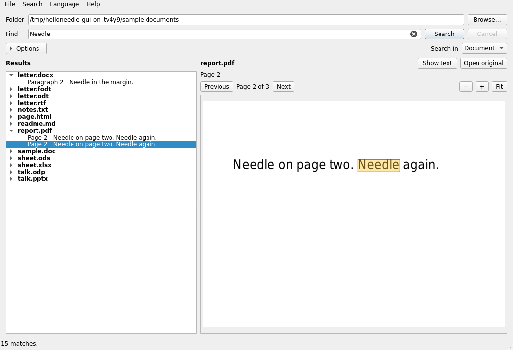

# Hello Needle


Hello Needle finds a word or phrase inside the documents on your computer. Choose a folder and it searches the files in that folder and its subfolders. Select a match to see the sentence in a Word document, the cell in a spreadsheet, or the highlighted words on a PDF page. The application runs on FreeBSD, Ubuntu, Windows, and macOS, in English and Spanish.

Created by **Alfredo Llaquet-Alsina**. Programmed by **ChatGPT**.

## Download Hello Needle

Hello Needle 1.0.0 is free to download and use. Choose the file for your computer.

| Your system | Download | Installation instructions |
| --- | --- | --- |
| **FreeBSD 15.1, amd64** | [Download the FreeBSD package (.pkg)](https://github.com/AlfredoLlaquet/helloneedle/releases/download/v1.0.0/helloneedle-1.0.0.pkg) | [Install on FreeBSD](#install-on-freebsd) |
| **Ubuntu 24.04 LTS, amd64** | [Download the Ubuntu package (.deb)](https://github.com/AlfredoLlaquet/helloneedle/releases/download/v1.0.0/helloneedle_1.0.0_amd64.deb) | [Install on Ubuntu](#install-on-ubuntu) |
| **Windows 10 (1903 or later) or Windows 11, x64** | [Download the Windows installer (.exe)](https://github.com/AlfredoLlaquet/helloneedle/releases/download/v1.0.0/HelloNeedle-1.0.0-Windows-x64-Setup.exe) | [Install on Windows](#install-on-windows) |
| **macOS 15 or later, Apple Silicon or Intel** | [Download the Mac disk image (.dmg)](https://github.com/AlfredoLlaquet/helloneedle/releases/download/v1.0.0/HelloNeedle-1.0.0-macOS-Universal.dmg) | [Install on macOS](#install-on-macos) |

The Windows x64 installer also runs on Windows 11 on Arm. The Mac download runs natively on both kinds of Mac. The release page includes the source code and checksums for these exact files. [Hello Needle 1.0.0 release](https://github.com/AlfredoLlaquet/helloneedle/releases/tag/v1.0.0)

### Install on FreeBSD

Download `helloneedle-1.0.0.pkg`. Open a terminal in the folder containing the download and run this command as **root**. The `./` tells `pkg` to install that file. It will fetch any missing dependencies from your configured FreeBSD repositories.

```sh
pkg install ./helloneedle-1.0.0.pkg
```

Back in your desktop account, open the application menu and search for **Hello Needle**, or run `helloneedle` in a terminal. To open a particular folder at startup, run `helloneedle "$HOME/Documents"`. To uninstall, run `pkg delete helloneedle` as root.

### Install on Ubuntu

Download `helloneedle_1.0.0_amd64.deb`. In the folder containing it, run the following command. APT installs Hello Needle and the libraries and document readers it needs.

```sh
sudo apt install ./helloneedle_1.0.0_amd64.deb
```

Open **Hello Needle** from the applications menu, or run `helloneedle` in a terminal. To uninstall, run `sudo apt remove helloneedle`. On both Ubuntu and FreeBSD, install a newer package the same way, using its new filename.

### Install on Windows

1. Open `HelloNeedle-1.0.0-Windows-x64-Setup.exe`. Choose English or Spanish and follow Setup. It installs for your account and offers a desktop shortcut.
2. Open **Start**, type **Hello Needle**, and select it. The installer includes everything needed to search PDFs and Word files.
3. To update, close Hello Needle and run the newer installer. To uninstall, open **Settings → Apps**, find **Hello Needle** in the list, and select **Uninstall**.

Windows can display **Unknown publisher** because the installer has no Windows publisher certificate. GitHub provides a signed record of the file it built. [Verify a download](#verify-a-download)

### Install on macOS

1. Open `HelloNeedle-1.0.0-macOS-Universal.dmg` in Finder. Drag **Hello Needle** onto the **Applications** shortcut in the disk image.
2. Eject the disk image and open **Hello Needle** from **Applications**. The app includes its PDF and Word readers.
3. To update, quit the app and replace it with the newer copy. To uninstall, move **Hello Needle** from Applications to the Trash.

The app has an ad hoc signature and has not been notarized by Apple. If macOS blocks the first launch, verify the download. Apple explains how to approve a specific app in **System Settings → Privacy & Security**. [Apple’s guide to opening downloaded apps](https://support.apple.com/en-us/102445)

## Find a passage

1. Click **Browse…** beside **Folder** and choose the folder containing your documents.
2. Type a word or phrase in **Find** and press **Enter**. Hello Needle lists the files containing it. Expand a filename to see each occurrence.
3. Select an occurrence to read it in the preview. **Open original** opens the file in its usual application. Searching and previewing leave your documents untouched.

In this FreeBSD screenshot, the search found `Needle` twice on page 2 of `report.pdf`. The second result is selected, so the preview highlights the second occurrence. **Show text** displays the words as selectable text. **Show page** returns to the printed page.



### Documents and previews

| Kind of document | What the preview shows |
| --- | --- |
| Plain text (.txt) and text-based source files | The matching line, its line number, and the lines around it. |
| HTML and Markdown (.html, .md) | The formatted passage, or the line of markup where the match occurs. |
| PDF (.pdf) | The page with the matching words highlighted. Zoom in, fit the page, or move to the previous or next page. A scanned PDF needs a searchable text layer. |
| Microsoft Word (.doc, .docx), Rich Text (.rtf), and OpenDocument Text (.odt, .fodt) | The paragraph containing the match, with nearby text. DOCX, ODT, and FODT can also identify the matching table row and column. Open the original to see its full page layout. |
| Excel and OpenDocument spreadsheets (.xlsx, .ods) | The sheet name and cell address, such as `Quarterly!C7`, for matching text or stored values. |
| PowerPoint and OpenDocument presentations (.pptx, .odp) | The slide number and the passage containing the match. |

### Search the words or the markup

Leave **Search in** set to **Document** to find the words as a person reads them. For example, a search for `paper lantern` finds `paper **lantern**` in Markdown and `paper <strong>lantern</strong>` in HTML. The bold formatting can split the phrase in the file, but the words still read as one phrase.

Choose **Source** to search the saved HTML or Markdown itself. A search for `<strong>` then finds the opening tag. Plain text files are searched line by line in either mode.

### Narrow a search

Open **Options** to limit the search to certain files or change what counts as a match.

- Set **Path filter** to `*.pdf` to search just the PDFs in the folder and its subfolders.
- Turn on **Case sensitive** to distinguish `May` from `may`. Turn on **Regular expression** to search for a pattern.
- Turn on **Search file names** to include matches in filenames as well as in their contents. **Include hidden files** and **Include ignored files** let you search files the default search skips.

Press **Escape** to cancel a search. **Ctrl+F** returns to the search field and **Ctrl+O** opens the folder chooser. On a Mac use **Command+F** and **Command+O**. If a file cannot be read, the other files are still searched. Click **Details…** beside the status message to see which file caused the problem.

### English and Spanish

Choose **Language → Español** or **Language → English**. The choice is remembered the next time the application opens. Both settings can search documents in other languages.

**En español.** Pulsa **Examinar…** para elegir la carpeta. Escribe una palabra o frase en **Buscar**, pulsa **Intro** y selecciona una coincidencia para leerla. En HTML y Markdown, **Documento** busca el texto que se lee en la página y **Código fuente** permite buscar las etiquetas y el marcado.

## Verify a download

Hello Needle uses GitHub’s immutable releases. Once a version is published, its files are locked. To check your download, run the following command in the folder where you saved it, using a recent version of the GitHub CLI. This example checks the FreeBSD package. For another system, substitute the name of the file you downloaded.

```sh
gh release verify-asset v1.0.0 helloneedle-1.0.0.pkg --repo AlfredoLlaquet/helloneedle
```

For a checksum check on FreeBSD, run `sha256 -q helloneedle-1.0.0.pkg` and compare the result with the line for that filename in the [1.0.0 checksum list](https://github.com/AlfredoLlaquet/helloneedle/releases/download/v1.0.0/SHA256SUMS). GitHub also signed the original build records for the Windows installer and Mac disk image. [Windows build record](https://github.com/AlfredoLlaquet/helloneedle/attestations/71362854) · [Mac build record](https://github.com/AlfredoLlaquet/helloneedle/attestations/71361503)

## Build from source

These instructions build the current source. Pick your system below. To build the exact 1.0.0 release, download the [1.0.0 source archive with its Rust libraries](https://github.com/AlfredoLlaquet/helloneedle/releases/download/v1.0.0/helloneedle-1.0.0-source-f357c30da0a5212f232ee32078d56d90ce67b3d1.tar.gz), extract it, and open a terminal in the extracted folder. Then skip the `git clone` and `cd helloneedle` lines.

[FreeBSD](#build-and-run-on-freebsd) · [Ubuntu](#build-and-run-on-ubuntu) · [Windows](#build-and-run-on-windows) · [macOS](#build-and-run-on-macos)

### Build and run on FreeBSD

On FreeBSD 15.1, install the compiler tools, Qt, and the PDF and Word readers as **root**. The C++ compiler comes with the base system.

```sh
pkg install git cmake ninja rust python3 qt6-base qt6-translations poppler-utils antiword
```

As your **desktop account**, get the source and build the application.

```sh
git clone https://github.com/AlfredoLlaquet/helloneedle.git
cd helloneedle
cmake -S . -B build-qt -G Ninja -DCMAKE_BUILD_TYPE=Release
cmake --build build-qt --parallel
```

You can run `./build-qt/bin/helloneedle` immediately. To install it for everyone, run the following command as **root** from the same `helloneedle` folder.

```sh
cmake --install build-qt --prefix /usr/local
```

Open **Hello Needle** from the application menu or run `helloneedle` as your desktop account. To update a Git checkout, quit Hello Needle, run `git pull --ff-only` in the checkout as your desktop account, then repeat the build and install commands.

### Build and run on Ubuntu

On an Ubuntu 24.04 desktop, open Terminal and install the development packages.

```sh
sudo apt update
sudo apt install git curl build-essential cmake ninja-build python3 qt6-base-dev \
  qt6-qpa-plugins qt6-translations-l10n poppler-utils antiword
```

The build also needs Rust 1.85 or later and Cargo. If those are already installed, skip the Rust installer and continue with the Git commands. Otherwise run the official Rust installer as your normal account, accept the default installation, and load its settings in this terminal. [Rust installation instructions](https://rust-lang.org/tools/install/)

```sh
curl --proto '=https' --tlsv1.2 -sSf https://sh.rustup.rs | sh
. "$HOME/.cargo/env"
```

Get the source, compile it, and install it under `/usr/local`.

```sh
git clone https://github.com/AlfredoLlaquet/helloneedle.git
cd helloneedle
cmake -S . -B build-qt -G Ninja -DCMAKE_BUILD_TYPE=Release
cmake --build build-qt --parallel
sudo cmake --install build-qt --prefix /usr/local
```

Open **Hello Needle** from the applications menu or type `helloneedle` in Terminal. To update a Git checkout, quit the application, run `git pull --ff-only` in the checkout, then repeat the build and install commands.

### Build and run on Windows

Install the x64 edition of MSYS2. From **Start**, open **MSYS2 UCRT64** and run `pacman -Syu`. If the update closes the terminal, reopen **MSYS2 UCRT64** and run the command again to finish. Use that terminal for all the commands below. [Download MSYS2](https://www.msys2.org/)

Install Git, the UCRT64 compilers, Qt, and the document readers.

```sh
pacman -S --needed git \
  mingw-w64-ucrt-x86_64-{gcc,cmake,ninja,rust,python} \
  mingw-w64-ucrt-x86_64-{qt6-base,qt6-translations,poppler,poppler-data,antiword}
```

Get the source, build it, and install a local copy in a folder named `stage` inside the checkout.

```sh
git clone https://github.com/AlfredoLlaquet/helloneedle.git
cd helloneedle
cmake -S . -B build-qt -G Ninja -DCMAKE_BUILD_TYPE=Release
cmake --build build-qt --parallel
cmake --install build-qt --prefix "$PWD/stage"
"./stage/Hello Needle.exe"
```

With MSYS2 in its default location, you can also double-click **Hello Needle.exe** in `stage` in File Explorer. This copy uses the libraries supplied by MSYS2. The downloadable Setup installer includes its own libraries. To update a Git checkout, close Hello Needle, run `git pull --ff-only` in the checkout, and repeat the build and install commands.

### Build and run on macOS

On macOS 15 or later, install Apple’s command line developer tools with `xcode-select --install` if needed. Install MacPorts for your version of macOS. If MacPorts needs to compile Qt locally and requests the full Xcode application, install the version it specifies. [MacPorts installation instructions](https://www.macports.org/install.php)

Open Terminal and install the tools and libraries. The commands use the standard MacPorts location, `/opt/local`.

```sh
export PATH="/opt/local/bin:/opt/local/sbin:$PATH"
export CMAKE_PREFIX_PATH=/opt/local/libexec/qt6:/opt/local
sudo /opt/local/bin/port install cmake ninja rust cargo python313 qt6-qtbase qt6-qttranslations poppler antiword
```

Get the source and compile it for your Mac’s processor. Install the application in your own **Applications** folder.

```sh
git clone https://github.com/AlfredoLlaquet/helloneedle.git
cd helloneedle
cmake -S . -B build-qt -G Ninja -DCMAKE_BUILD_TYPE=Release \
  -DPython3_EXECUTABLE=/opt/local/bin/python3.13
cmake --build build-qt --parallel
cmake --install build-qt --prefix "$HOME/Applications"
```

Apply the local signatures and open the app. You can launch it from Finder afterward.

```sh
app="$HOME/Applications/Hello Needle.app"
codesign --force --sign - "$app/Contents/MacOS/helloneedle-worker"
codesign --force --sign - "$app"
open "$app"
```

This copy uses Qt and the readers installed by MacPorts. The downloadable Universal disk image includes those libraries and works on either processor. To update a Git checkout, quit Hello Needle, run `git pull --ff-only` in the checkout, then repeat the build, install, and signing commands.

## License and credits

Hello Needle is free software under the **GNU General Public License, version 3 or later**, and is distributed without warranty. The license covers the program. You retain your rights to the documents you search. Hello Needle grew out of **Clapgrep**, written by Leopold Luley and its contributors. Bundled libraries, converters, and artwork retain their own licenses and credits.

Open **Help → Licenses** to read the notices offline. The release includes the matching source code and build instructions for the bundled software. [GNU GPL](LICENSE) · [Credits and third-party licenses](NOTICE.md)
